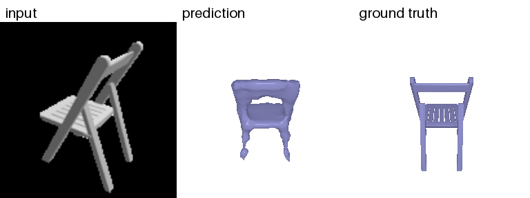
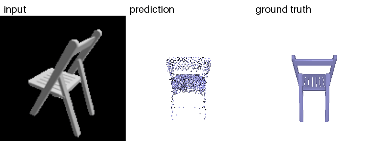
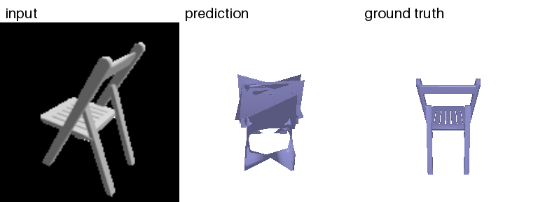
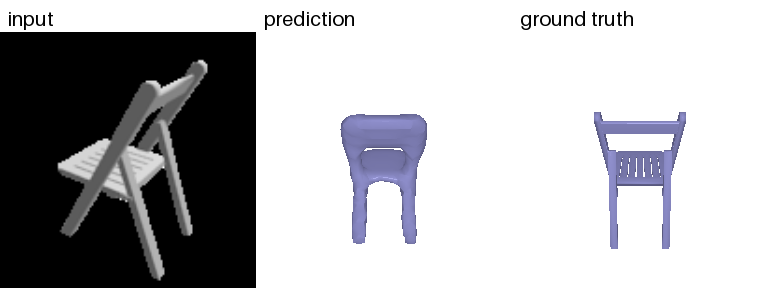

# Single View to 3D

Based on assignment 2 from 16-825 Learning for 3D Vision

## Representations

### Voxels

[Pix2Vox-A](https://arxiv.org/abs/1901.11153) decoder.

| F1@0.05 | F1@0.02 | F1@0.01 |
|---------|---------|---------|
| 87.3 | 25.7 | 4.6 |



### Points - 1000 points

[Fully connected](https://arxiv.org/abs/1612.00603) decoder.

| F1@0.05 | F1@0.02 | F1@0.01 |
|---------|---------|---------|
| 94.3 | 51.6 | 11.6 |



### Mesh

Fully connected decoder that deforms an ico sphere.

| F1@0.05 | F1@0.02 | F1@0.01 |
|---------|---------|---------|
| 91.8 | 43.2 | 9.7 |



### Implicit - occupancy function

[Occupancy Networks](https://arxiv.org/abs/1812.03828) decoder, evaluated on a 32^3 query grid.

| F1@0.05 | F1@0.02 | F1@0.01 |
|---------|---------|---------|
| 88.2 | 28.9 | 5.5 |



## Data

Put the R2N2 / ShapeNet dataset in `data/r2n2_shapenet_dataset`, then make the cache in `data/r2n2_chairs`:

```bash
python scripts/prepare_data.py
```

## Training

```bash
python scripts/train_voxel.py
python scripts/train_point.py
python scripts/train_mesh.py
python scripts/train_implicit.py
```

## Evaluation

```bash
python scripts/evaluate_voxel.py --checkpoint runs/voxel/best.pt
python scripts/evaluate_point.py --checkpoint runs/point/best.pt
python scripts/evaluate_mesh.py --checkpoint runs/mesh/best.pt
python scripts/evaluate_implicit.py --checkpoint runs/implicit/best.pt
```

## Visualization

```bash
python scripts/visualize_voxel.py --checkpoints runs/voxel/best.pt
python scripts/visualize_point.py --checkpoints runs/point/best.pt
python scripts/visualize_mesh.py --checkpoints runs/mesh/best.pt
python scripts/visualize_implicit.py --checkpoints runs/implicit/best.pt
```
